# Decision: a small host, reviewed plugins

Status: proposed host architecture; locally implemented protocol pilot, API v1.

The Data Hub owns its domain schemas, editor, diff/review semantics and candidate
preparation. Boardwalk owns identity, admission, installation policy, grants,
storage transactions, audit/retention, rendering registration and public activation.
The host should not absorb a second large feature workflow just to host this one.

```mermaid
flowchart LR
  Staff --> Shell[Boardwalk shell and lazy plugin route]
  Shell --> Plugin[Reviewed pinned plugin UI]
  Plugin --> Bridge[Host authenticated bridge]
  Bridge --> API[Host gateway and trusted principal]
  API --> Core[Plugin schema and review transition]
  Core --> Tx[Host transaction: revision plus history and audit]
  Tx -. future reviewed candidate .-> Owner[Existing publication owner]
  Owner -. complete verified family .-> Public[Hub plus latest embeds and exports]
```

The manifest declares identity, version, protocol major, a namespaced route and
namespaced requested capabilities. It contains no JavaScript URL or credentials.
The host statically imports reviewed code and independently allowlists identity,
version and capability set. It chooses the route and supplies the bridge. A plugin
cannot approve its own install, create grants, register arbitrary backend handlers,
read provider credentials or publish merely by declaring permissions.

The shared mount/unmount contract works for non-React code and future plugins;
a React host wrapper manages its lifecycle. Plugin-specific capability checks
remain server-side. UI action availability is advisory. Failure to load one plugin
uses the existing route error boundary and must leave unrelated CMS work usable.

First-party modules run with the host origin's browser privileges. Neither the
DOM container nor this manifest is a security sandbox. Do not load community
JavaScript into this host. A future untrusted-plugin program needs an isolated
origin/frame, restrictive CSP, strict message protocol, capability mediation,
storage quotas, revocation and its own threat model before remote installation.

For subsequent first-party plugins, add a reviewed namespaced installation entry
and adapter rather than new special cases in App.tsx. Reject duplicate route/ID
registrations, make activation/grants auditable, expose compatibility failures and
support disabling a plugin without deleting retained data. This pilot demonstrates
a second allowlisted manifest in tests; it does not provide a marketplace, admin
installation UI or a complete multi-plugin registry.

Keep the contract here until two real plugins expose what must be shared. Then
extract a small versioned `plugin-api` package with host/plugin conformance fixtures.
Avoid prematurely turning the editorial model or release machinery into a general
plugin SDK. Version code and content schemas separately. Pin 0.x packages exactly;
review compatibility and retain old public renderer/artifact support before upgrading.

Read-only preview/export code must consume a privacy-safe projection from the same
schema as the reviewed candidate. Do not duplicate chart logic in the editor.
A no-code data update becomes possible only after approved schema/reader adapters
and the atomic publication path are installed. A brand-new chart type still needs
a reviewed code release.

The initial host delivery uses a digest-verified committed package snapshot because
Boardwalk's immutable Functions compiler disallows arbitrary package imports. The
external repository remains the authoring source. See the delivery section in the
integration investigation for the facade, parity and release-graph requirements.
